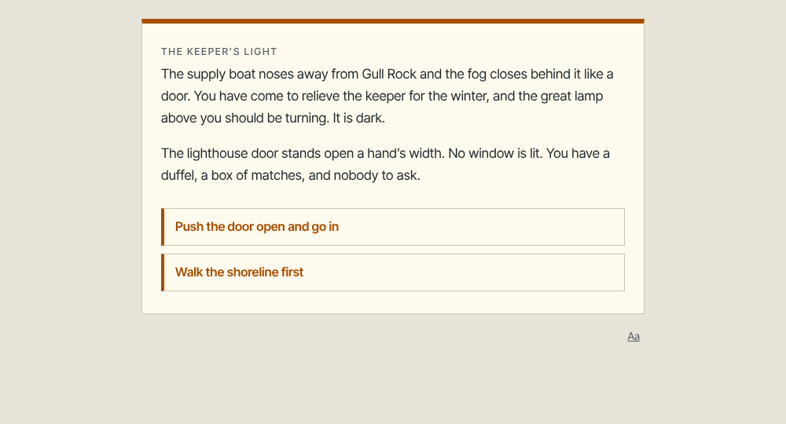
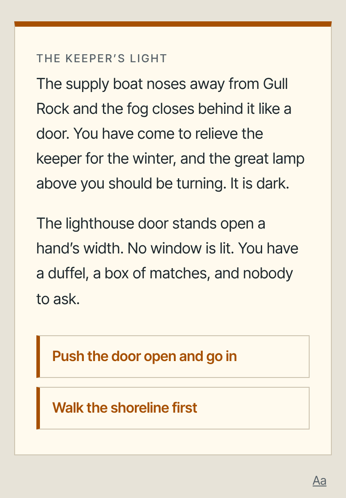
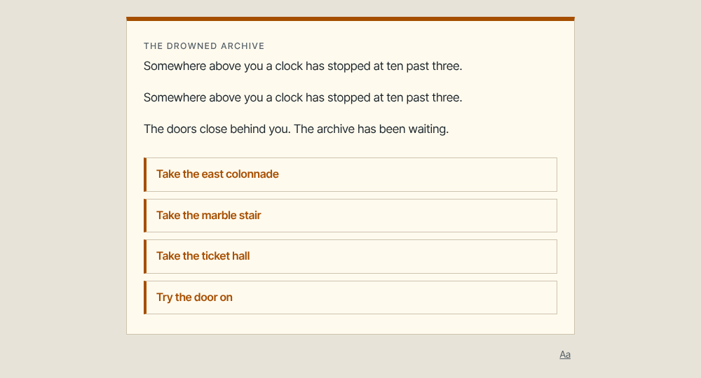
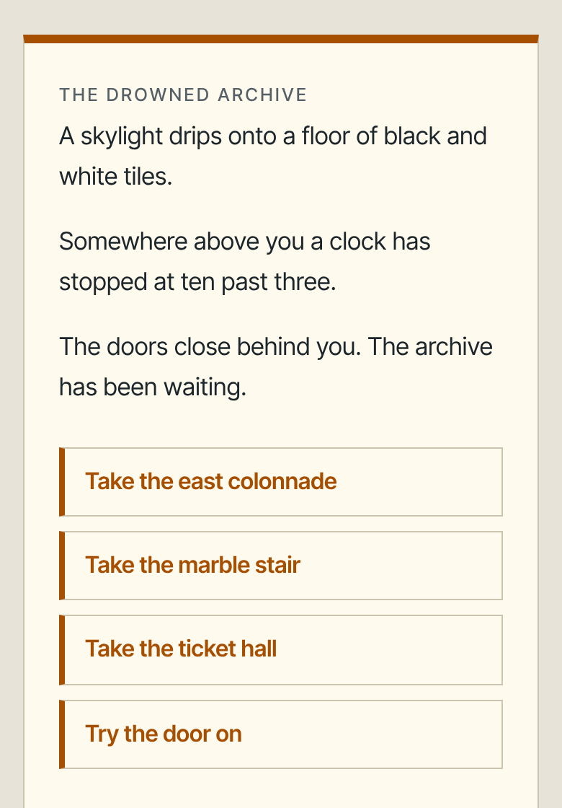
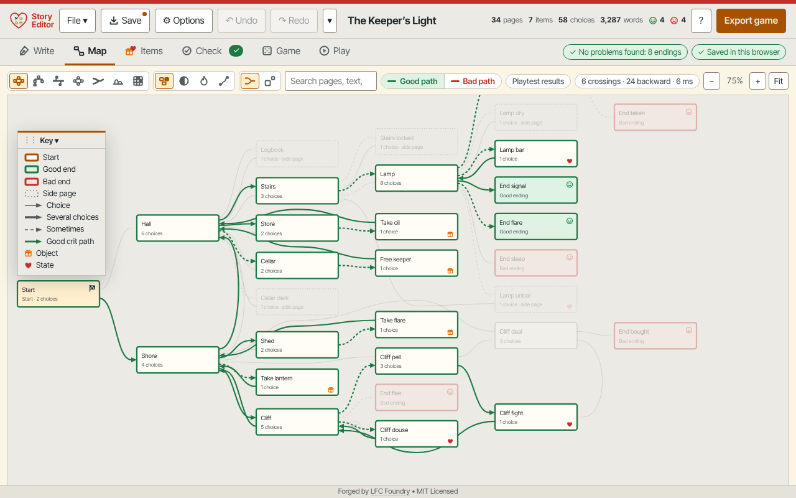

<div align="center">

# Story Editor

**Write a branching story, find out it really works, and share it as one small game file.**

[**Open the editor**](https://lfcfoundry.github.io/story-editor/play/) · [**Landing page**](https://lfcfoundry.github.io/story-editor/) · [**Reusable packages**](#code-you-can-reuse)

   

</div>

## What it is and how it works

A single-file, offline editor for branching "choose your own path" stories, with a built-in checker that finds what is broken.

- **Write** pages and choices. Keys, states, numbers and dice are fields you fill in, not code.
- **Check** every route as you type. It finds dead ends, unreachable pages and endings no one can reach, and says why.
- **See** the story as a Story Page Map you can search and click.
- **Share** one small HTML game, about 25 to 50 KB, that plays on almost any device, offline.

You can also download `index.html` from this page and double-click it; nothing needs installing.

## Why it exists

Branching stories break in ways rereading cannot catch, like an ending that needs a key only another route hands out. Because the rules are data rather than code, the editor can test every situation instead of hoping a playtester stumbles on the problem. And because it is one offline file, a story does not depend on a website, an account or an install. How it compares with Twine, Ink, Yarn Spinner and ChoiceScript, with sources, is in [docs/FORMAT-COMPARISON.md](docs/FORMAT-COMPARISON.md).

### What people use it for

- Classrooms, on computers that allow no installs
- Writers confirming every ending is reachable before readers see it
- Game designers testing keys, stats and dice
- Training scenarios where no path should dead-end
- Twine authors who want a second check
- Developers reusing the checker, player or map as MIT packages

## Highlights

| Works with Twine and your devices | No ads, no accounts, no network | One file that runs almost anywhere | Open source, with a quick tour | Exact checker | Story Page Map |
|---|---|---|---|---|---|
| Imports Twine 2 HTML, Twee 3 and Twine 1 stories, turns SugarCube and Harlowe code into rules and tells you in plain words what could not carry over. Runs in Firefox, Chrome, Edge and Safari on computers, Android and iPhone or iPad. Exported games run in somewhat older browsers still. | No ads, no sign-in, no tracking and no data sent anywhere. The editor is not allowed to make a network connection at all, so your story never leaves your device, and everything works offline. | The whole editor is one 298 KB HTML file. Nothing to install, no administrator rights and no special computing knowledge: open it in your browser. It fits phones, tablets and computers at almost any screen size, and a finished game is one small file too, about 25 to 50 KB. | MIT licensed and free to use, change and share. The first time you open the editor a short spotlight tour shows the main areas; replay it from Options, Take the tour, or read the Quick guide inside the editor. | Tries every combination of items, numbers and dice to find dead ends and unreachable endings. | Several views, from a plain flow to a bird's-eye shape of the whole story, with your pages, choices and routes drawn as a picture you can search and click. |

## By the numbers

Measured in Chromium 155, Firefox 158 and WebKitGTK 2.52, on one 4-core machine, from the single file the editor ships as (median of repeated runs; lower is better). The checker rows were measured again on 2026-10-31 as the average of many repeated checks; the other rows are from 2026-10-29.

| Measure (lower is better) | Chromium | Firefox | WebKitGTK |
|---|---:|---:|---:|
| Check after an edit, The Keeper's Light (34 pages, 649 situations) | 0.7 ms | 0.7 ms | 0.7 ms |
| Check after an edit, a generated test story (316 pages, 24,313 situations) | 6.8 ms | 7.3 ms | 7.2 ms |
| Check after an edit, a generated 100-page story (78,726 situations) | 25 ms | 28 ms | 29 ms |
| Same 316-page check, JavaScript only (no WebAssembly) | 33 ms | 47 ms | 43 ms |
| Lay out the Story Page Map of 316 pages (layout only, warm) | 2.4 ms | 3.0 ms | 2.9 ms |
| Open the Story Page Map of 316 pages, first time | 48 ms | 27 ms | 72 ms |
| Open the editor from the file, ready to type | 285 ms | 369 ms | 932 ms |

### Why it is this fast

These numbers are no accident. A significant effort went into making the story engine fast, so that it keeps up as stories grow. As games become far more massive, their mechanics more sophisticated, their visuals richer, and their playthroughs wildly different, logical and fun paths, the engine is built to scale with that complexity instead of slowing under it.

The editor is one 298 KB file. A finished game is 42 KB for 34 pages and 45 KB for a generated 316-page story. Every build plays 400 random stories out move by move and requires the checker to agree. Firefox rounds its timers to whole milliseconds. More on the landing page: [about.html](https://lfcfoundry.github.io/story-editor/about.html).

## Try an example story

- [Play The Keeper's Light](https://lfcfoundry.github.io/story-editor/examples/the-keepers-light.html): you step off the supply boat onto Gull Rock to relieve the keeper for the winter, and the great lamp is dark. 34 pages, 8 endings, four objects, three states, a game file of 42 KB that works offline. A typical playthrough is 10 to 14 choices, about 7 minutes (shortest 3 choices, longest 22).
- [Play The Drowned Archive](https://lfcfoundry.github.io/story-editor/examples/the-drowned-archive.html): you cross a tidal causeway to the Meridian Archive, a building that floods twice a day, whose keeper has stopped answering letters and whose clock has stopped at ten past three. 51 pages, 8 endings, two numbers (Tide and Nerve), a dice check, locked choices, and a question before page one (an heir, an inspector or a thief) that changes the story. The quick endings take 1 to 6 choices; the two good endings take 21 to 25 choices even by the shortest route, about 9 to 11 minutes.
- Playthrough times are estimates from the checker's shortest routes at about 200 words a minute plus a few seconds per choice, not timings of real readers.

 

 

The Story Page Map of The Keeper's Light with the good paths lit in green:



- To open one in the editor: [download The Drowned Archive as a .story.json](examples/the-drowned-archive.story.json), or [download The Keeper's Light as a .story.json](examples/the-keepers-light.story.json) and use Open, or choose File, then Example story or Massive example.

## Code you can reuse

Everything is MIT-licensed and has no dependencies. The editor's logic was cut out into small packages, **generated from the editor's own sources** (so there is one copy to maintain, and a test fails if they drift apart). Each folder has a README (what it does, how it differs from what already exists, its limits), an `AGENTS.md` for AI helpers, TypeScript types, an example you can run, and tests that require **identical answers to the editor** on hundreds of random stories.

| Package | One line |
|---|---|
| [story-format](packages/story-format/README.md) | The data model for branching stories as plain JSON, with a JSON Schema, a safe sanitizer for any input, a plain-text story syntax, find/replace, Markdown manuscript. |
| [twine-import](packages/twine-import/README.md) | Reads Twine stories (Twine 2 HTML, Twee 3, Twine 1) and turns SugarCube and Harlowe code into rules, with a plain-words report of what it could not carry over. |
| [story-outline](packages/story-outline/README.md) | Turns an indented outline (page names, choices indented under them) into pages and choices, or into a whole story. |
| [story-diff](packages/story-diff/README.md) | Says in plain words what one edit did to a story: "Add page “The Cellar”", "Delete a choice on “Start”". |
| [story-check](packages/story-check/README.md) | An exact checker: explores every combination of items, numbers and dice to find dead ends and endings no player can reach, and says why. |
| [story-player](packages/story-player/README.md) | One story in, one small offline HTML game out; plus a "play it from code" session and a terminal player. |
| [story-map](packages/story-map/README.md) | Layered, arc, matrix and shape drawings of a story graph, choke points, simulated players, drawing metrics, SVG output. |
| [zip-page](packages/zip-page/README.md) | Shrinks one HTML page into a self-unzipping page, with a small readable inflater as fallback. |
| [qa-kit](packages/qa-kit/README.md) | A tiered test runner and a Playwright-style call surface over Puppeteer's WebDriver BiDi, so suites also run on stock Firefox; a seeded random-story generator. |
| [contract-kit](packages/contract-kit/README.md) | A guide, with a small helper, for keeping two implementations of one rule set from drifting apart (a fast checker and a slow reference, an editor and its exported game): random inputs, side-by-side comparison, a field table, a time limit. |
| [ai-collab-kit](packages/ai-collab-kit/README.md) | A written process for a person and an AI assistant building software together: ten habits, test and speed recipes, pitfalls, templates. |
| [editor/](editor/README.md) | The full editor sources, its build, and its browser test suites ([editor/qa](editor/qa/README.md)). |

Only pieces that are not already well covered by open source were split out; each README names the closest existing projects and says honestly how this one differs. Small pieces for browser games (curtains, saves, frame pacing and more) live in the sibling repository [JS-modules](https://github.com/lfcfoundry/JS-modules).

## Build and test from source

```
npm install                 # esbuild and prettier, for the package build
npm run build               # regenerate packages/*/src/generated.js and dist/ from editor/*.js
npm test                    # packages up to date, README samples, every package's tests, the editor's contract test (no browser needed)
npm run editor              # build the editor: editor/story-editor.html (needs Python 3 and one npm install)
```

The browser suites (Firefox, Chromium and WebKitGTK) are in `editor/qa`; see its README. For people and AI helpers: [AGENTS.md](AGENTS.md), [llms.txt](llms.txt), [CONTRIBUTING.md](CONTRIBUTING.md). History and measurements: [docs/](docs/README.md).

## Your stories stay yours

- The editor works offline and sends nothing anywhere. Your stories are kept in your own browser as you type.
- **Save** (Ctrl+S) also writes a `.story.json` file you can keep, back up or move to another device, and **Open** brings it back.
  In Chrome and Edge, Save writes straight back to the same file; Firefox and Safari download a copy each time.
- If the latest autosave can't be read, the editor opens the spare copy it keeps and tells you.

## The quick tour

The first time you open the editor it offers a short spotlight tour of the main areas; replay it any time from **Options → Take the tour**.

1. **Write:** add a page, type its text, add choices and point each choice at another page. Mark a page as an ending (good, bad or neutral).
   Press **Ctrl+K** to jump to any page by typing part of its name; the same type-to-find box picks where a choice leads. ‹ › step back and forward,
   the panel buttons hide the side lists, click an item to give it, paste a scene with `-` lines as choices, and Ctrl+Shift+Enter splits a page at the cursor. Drag the ⋮⋮ grip to reorder choices and paragraphs. The first page can never be an ending.
2. **Check:** the Check tab tells you about pages nobody can reach, choices that lead nowhere, endings players can't get to, and traps.
3. **Map** (the Story Page Map): see the whole story as a picture. Several views, from a plain flow to a bird's-eye "story shape". Click a page to open it.
4. **Items:** objects and states players can get or lose, numbers (with bars), dice skill checks, and locked choices. Turn on
   **Options → Advanced** to show more tools.
5. **Play:** try the story right inside the editor, or start from any page with "Test from here".
6. **Share:** **Export game** makes one small HTML file (about 25-50 KB for a typical story). Send it to anyone; it opens in any
   modern browser, online or off. **Options → Quick guide** inside the editor explains each part in plain words.

## Handy while writing

- **Actions from the keyboard:** in the Ctrl+K box, type `>` to list actions (go to a tab, play, new page, export, undo, show or hide the lists) and press Enter to run one.
- **On a phone,** the page type and effects open as a sheet that slides up from the bottom, the Story Page Map's toolbar folds its less-used tools behind "More", and the Story Page Map remembers whether you left its key shown or hidden.
- **Find and replace** (Ctrl+Shift+F, or **Find...** above the page list) searches every page name, heading, paragraph and choice.
- **Unfinished flag:** the bookmark button on a page marks it as unfinished; the Check tab lists them.
- **Why can't players reach this page?** is in a page's ... menu, and the Check tab lists pages no simulated player reached.
- **Game tab:** turn on **Options, Advanced, Game** and a Game tab appears between Check and Play. It holds the options for your exported
  games and a live preview of your own story; hover over or arrow through the colors to try each one.
- **Save manuscript (.md)** in the File menu writes all the words of your story as one text file for proofreading.

## What players of your game get

Saves their place automatically, a Back button (if you turn it on), a reader comfort button (Aa) for text size, spacing and colors,
an "endings found" count, and optional place codes to continue on another device. Games are accessible to screen readers and work on
phones, tablets and computers.

## Works in

Current Firefox, Chrome, Edge and Safari on computers, Android and iPhone/iPad. Exported games work in somewhat older browsers than the
editor does (roughly Chrome/Edge 80, Firefox 74, iOS 13.4 for games; Chrome/Edge 98, Firefox 98, iOS 15.4 for the editor).

**Browsers used to test each release.** The latest release was tested in Firefox 158.0, ungoogled Chromium 155.0.8059.39-1 and WebKitGTK 2.52.6, one at a time. The exact browsers for every release are in the maintainers' full technical changelog. The short list of changes is in [docs/CHANGELOG.md](docs/CHANGELOG.md).

## More from LFC Foundry

- [Apple Press](https://github.com/JNFoo/apple-press): a clicker game for kids ([play](https://jnfoo.github.io/apple-press/))
- [Fancy, the Banana](https://github.com/lfcfoundry/fancy-banana): a one-tap flying-banana arcade game ([play](https://lfcfoundry.github.io/fancy-banana/))
- [Pineapple Defense](https://github.com/JNFoo/pineapple-defense): a flick-to-throw pineapples-at-penguins game ([play](https://jnfoo.github.io/pineapple-defense/))
- [JS-modules](https://github.com/lfcfoundry/JS-modules): small dependency-free pieces for single-file browser games ([demos](https://lfcfoundry.github.io/JS-modules/))

## Credits and attributions

- Copyright (c) 2026 LFC Foundry, MIT License (see [LICENSE](LICENSE) and [NOTICE.md](NOTICE.md)). Forged by LFC Foundry ([github.com/lfcfoundry](https://github.com/lfcfoundry)).
- Written by JNFoo with AI assistance (Claude, by Anthropic). The packages are cut from the editor's own sources and contain no third-party source code.
- **Typeface:** Inter Tight, © 2016 The Inter Project Authors (https://github.com/rsms/inter), under the SIL Open Font License 1.1. The font files keep that license and are not covered by the MIT License.
- **Packer and decoder:** the LZMA packer and decoder in `editor/lzma/` are copied from the sibling [JS-modules](https://github.com/lfcfoundry/JS-modules) repository (`tools/lzma-pack`, `modules/lzma-decode`).
- **Twine and its story formats:** File → Import Twine… reads the *file formats* of Twine, SugarCube and Harlowe. No code, text or data was copied from them; their licenses (checked 2026-10-14) and the trademark notes are in [NOTICE.md](NOTICE.md). Twine, Ink, Yarn Spinner and ChoiceScript are compared from their public documentation in [docs/FORMAT-COMPARISON.md](docs/FORMAT-COMPARISON.md).
- **Sample story:** "The Keeper's Light" is an original story by JNFoo, included under the MIT License.
- **Tools you install yourself** keep their own licenses and are not part of this repository: esbuild, Prettier, Zopfli, Puppeteer, Playwright and the test browsers.
